  
  

把想法写成代码，把喜欢的事做成作品。

  <a href="https://herz1.github.io/">个人博客</a> &nbsp; / &nbsp;
  <a href="https://github.com/Herz1?tab=repositories">我的项目</a> &nbsp; / &nbsp;
  <a href="https://github.com/Herz1/ensei-techo">遠征手帳</a>

### 🧩 Toolbox

  

### ✨ A few things I've made

| 项目 | 关于它 |
| :--- | :--- |
| 🎫 [遠征手帳 · Ensei Techo](https://github.com/Herz1/ensei-techo) | 日本现场演出发现、票务跳转与远征计划管理 |
| 📝 [Personal Blog](https://herz1.github.io/) | 我的个人博客 |

### 📊 The public side of my GitHub

### 🐍 Every little square counts

<picture>
  <source media="(prefers-color-scheme: dark)" srcset="./assets/snake-dark.svg" />
  <source media="(prefers-color-scheme: light)" srcset="./assets/snake.svg" />
  
</picture>

👾 再开一局：吃豆人 & 打砖块

 

**Pac-Man · 吃掉每一份贡献**

<picture>
  <source media="(prefers-color-scheme: dark)" srcset="./assets/pacman-contribution-graph-dark.svg" />
  <source media="(prefers-color-scheme: light)" srcset="./assets/pacman-contribution-graph.svg" />
  
</picture>

**Breakout · 把贡献格子变成砖块**

<picture>
  <source media="(prefers-color-scheme: dark)" srcset="./assets/breakout-contribution-graph-dark.svg" />
  <source media="(prefers-color-scheme: light)" srcset="./assets/breakout-contribution-graph.svg" />
  
</picture>

🌃 换个角度：我的 3D 贡献城市

 

<picture>
  <source media="(prefers-color-scheme: dark)" srcset="./assets/city-dark.svg" />
  <source media="(prefers-color-scheme: light)" srcset="./assets/city.svg" />
  
</picture>

 

Made of curiosity & commits.

<!-- Animation credits: Platane/snk · abozanona/pacman-contribution-graph · yoshi389111/github-profile-3d-contrib. Icons: tandpfun/skill-icons. -->
