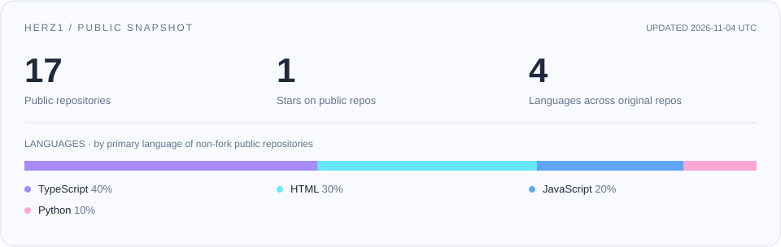
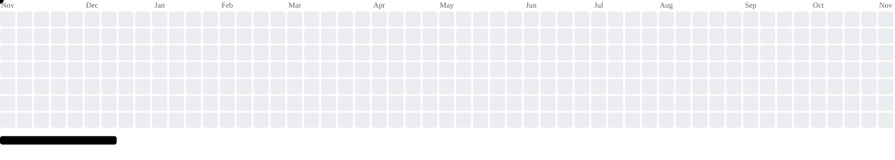
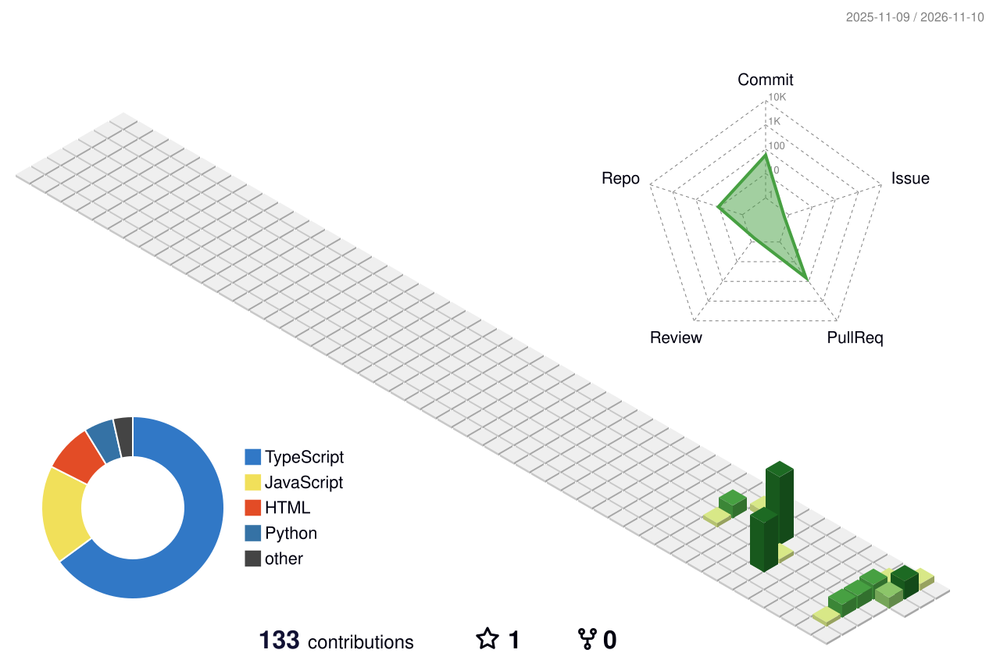

  

PERSONAL FIELD NOTES &nbsp;·&nbsp; CODE / FANTASY / EVERYDAY

  <strong>把想法写成代码，把喜欢的世界留下入口。</strong> 
  Interfaces, small experiments, field notes, and a few places to get lost in.

  <a href="https://herz1.github.io/">兔山手帖</a> &nbsp;·&nbsp;
  <a href="https://herz1.github.io/hrez1yun/">幻想郷通信</a> &nbsp;·&nbsp;
  <a href="https://github.com/Herz1/ensei-techo">遠征手帳</a> &nbsp;·&nbsp;
  <a href="https://herz1.github.io/project-archive/">Project Archive</a>

 

### 01 / 记录中

这里是 **Herz1** 的公开工作台：用 TypeScript 和 Web 技术搭建可玩的界面，用静态页面收藏角色、音乐与远征，也把实现过程写成可以回看的笔记。

最近反复做三件事：

- **把复杂的东西做得像一本手账**：地图、筛选、音频、动效，都要有清楚的入口。
- **把喜欢的东西做成能被访问的地方**：博客、角色站、应援页和小型档案。
- **把灵感拆成可复用的技术**：Canvas 数学、SVG 图形、CSS 动画与 GitHub Pages。

### 02 / Featured dispatches

| 作品 | 入口 | 一句话 |
| :--- | :--- | :--- |
| **遠征手帳 · Ensei Techo** | [源码](https://github.com/Herz1/ensei-techo) | 把演出发现、地图探索与赴日观演行程放进一本手账。 Next.js · TypeScript · MapLibre · Three.js |
| **幻想郷通信** | [体验](https://herz1.github.io/hrez1yun/) · [源码](https://github.com/Herz1/hrez1yun) | 把幻想乡写进浏览器：昼夜神社、极坐标弹幕与纯静态博客。 HTML · CSS · JavaScript |
| **爱弥斯应援站** | [体验](https://herz1.github.io/aemeath-fan-site/) · [源码](https://github.com/Herz1/aemeath-fan-site) | 用三种语言收藏角色的声音、故事与细节。 静态站点 · 多语言界面 · 音频交互 |
| **Project Archive** | [体验](https://herz1.github.io/project-archive/) · [源码](https://github.com/Herz1/project-archive) | 用光谱与三维档案整理公开项目，保留轻量目录供直接浏览。 |

### 03 / Technical notes

- [弹幕算法笔记：用极坐标画一朵「花」](https://herz1.github.io/hrez1yun/danmaku-math.html) — 从圆环、玫瑰线到黄金角螺旋，记录 Canvas 弹幕的数学与性能取舍。
- [用纯 SVG 画一只圆滚滚的年糕鸟](https://herz1.github.io/posts/css-mochi-bird.html) — 用基本图形、贝塞尔曲线与 CSS 动画，把静态角色变成会眨眼的看板娘。
- [把这个博客部署到 GitHub Pages 的完整笔记](https://herz1.github.io/posts/github-pages-deploy.html) — 从本地静态页面到公开站点，整理部署与自定义域名的完整过程。

### 04 / Toolbox

  

### 05 / Public observatory

  

### 06 / Every little square counts

<picture>
  <source media="(prefers-color-scheme: dark)" srcset="https://raw.githubusercontent.com/Herz1/Herz1/main/assets/snake-dark.svg" />
  <source media="(prefers-color-scheme: light)" srcset="https://raw.githubusercontent.com/Herz1/Herz1/main/assets/snake.svg" />
  
</picture>

👾 再开一局：吃豆人 & 打砖块

 

**Pac-Man · 吃掉每一份贡献**

<picture>
  <source media="(prefers-color-scheme: dark)" srcset="https://raw.githubusercontent.com/Herz1/Herz1/main/assets/pacman-contribution-graph-dark.svg" />
  <source media="(prefers-color-scheme: light)" srcset="https://raw.githubusercontent.com/Herz1/Herz1/main/assets/pacman-contribution-graph.svg" />
  
</picture>

**Breakout · 把贡献格子变成砖块**

<picture>
  <source media="(prefers-color-scheme: dark)" srcset="https://raw.githubusercontent.com/Herz1/Herz1/main/assets/breakout-contribution-graph-dark.svg" />
  <source media="(prefers-color-scheme: light)" srcset="https://raw.githubusercontent.com/Herz1/Herz1/main/assets/breakout-contribution-graph.svg" />
  
</picture>

🌃 换个角度：我的 3D 贡献城市

 

<picture>
  <source media="(prefers-color-scheme: dark)" srcset="https://raw.githubusercontent.com/Herz1/Herz1/main/assets/city-dark.svg" />
  <source media="(prefers-color-scheme: light)" srcset="https://raw.githubusercontent.com/Herz1/Herz1/main/assets/city.svg" />
  
</picture>

 

Made of curiosity, careful interfaces, and a little bit of magic.

<!-- Animation credits: Platane/snk · abozanona/pacman-contribution-graph · yoshi389111/github-profile-3d-contrib. Icons: tandpfun/skill-icons. Cover artwork generated with OpenAI image_gen. -->
